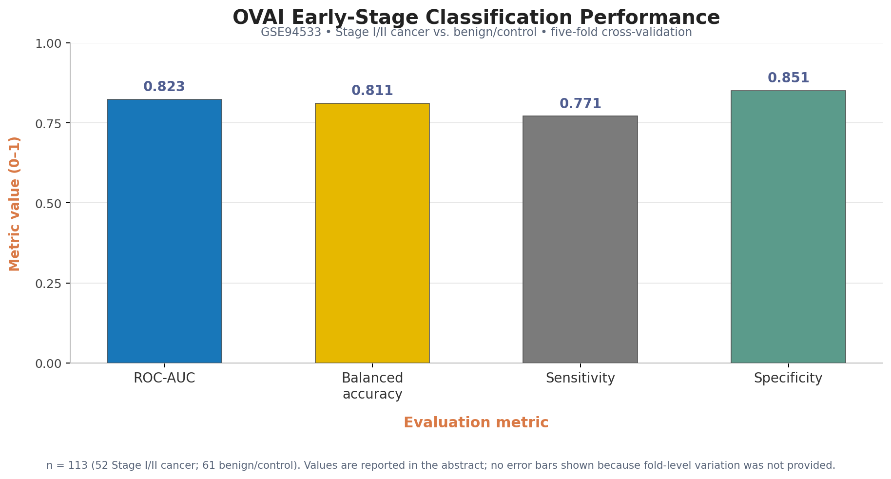
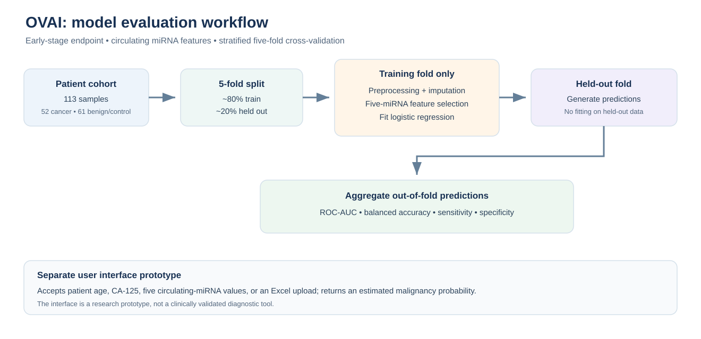
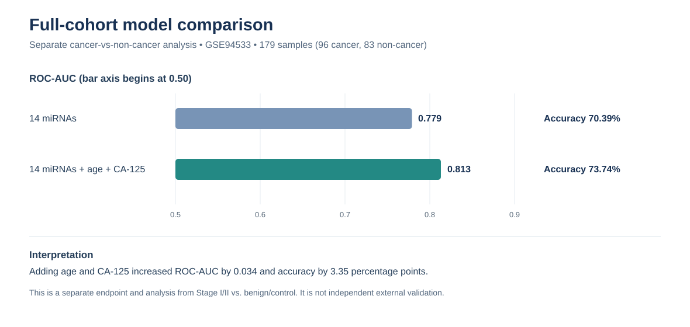
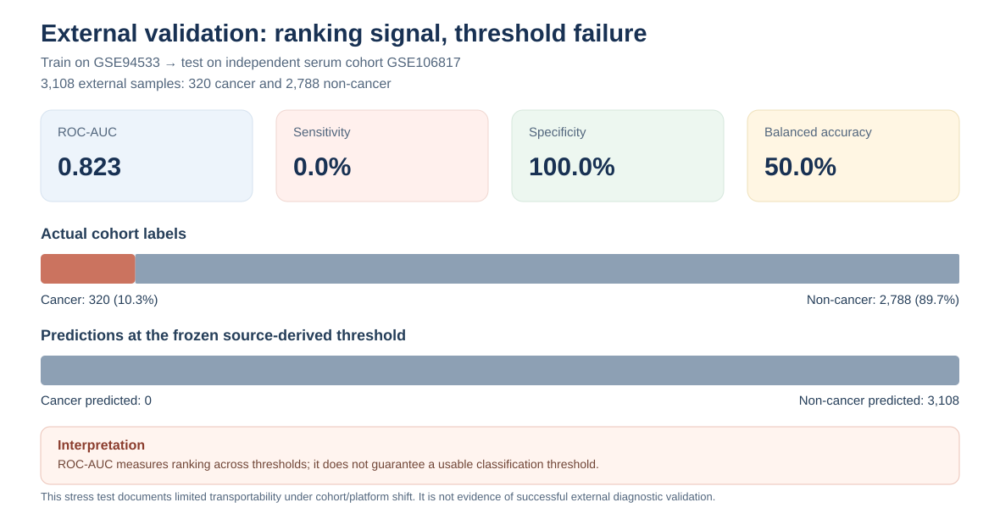

# OVAI: Evaluating Machine Learning for Ovarian Cancer Classification Using Circulating microRNAs and Clinical Variables

**Shaun Murzello, Ryan Agahian, Dylan Ardaya, Anthony Nguyen, Kush Rao, Caden Guo**  
October 2026

## Abstract

Epithelial ovarian cancer is frequently missed at less advanced stages, motivating research into biomarkers that could potentially improve its early-stage classification. We have developed OVAI, a machine-learning pipeline that is used to distinguish Stage I/II epithelial ovarian cancer samples from benign ovarian conditions and controls using circulating miRNA expression from blood samples. Using the publicly available GSE94533 cohort, we analyzed 113 patients for this task, including 52 Stage I/II cancer cases and 61 benign/control cases, excluding stage III/IV cancer cases and borderline tumors. We tested a logistic regression model using five selected miRNAs through five-fold cross-validation, repeatedly training on 80% of patients and testing on the remaining 20%. Feature selection and data preprocessing were performed using only the training data to prevent information leakage.

When tested using the five held-out folds, the model achieved a mean five-fold ROC-AUC of 0.823 and balanced accuracy of 81.1%, with 77.1% sensitivity and 85.1% specificity. We also developed an interface that allows users to enter patient age, CA-125 levels (a blood biomarker), and five circulating miRNA measurements or upload patient data in an Excel format, generating an estimated malignancy probability.

In a separate cancer vs. non-cancer analysis of the full 179-patient cohort, a regularized logistic regression model combining 14 miRNAs with age and CA-125 achieved a cross-validated ROC-AUC of 0.813, compared with 0.779 for the 14-miRNA model alone. These are preliminary estimates from a single cohort, not independent validation, which require further evaluation using an independent cohort with a similar structure to further assess the potential clinical utility.

**Keywords:** Ovarian cancer; Early-stage detection; Circulating microRNA; Machine learning; Biomarker discovery; Computational oncology; CA-125

## Figures

### Figure 1. Early-stage model performance

The early-stage analysis included 113 GSE94533 samples: 52 Stage I/II cancer cases and 61 benign/control cases. The chart shows the four metrics reported in the abstract: ROC-AUC 0.823, balanced accuracy 81.1%, sensitivity 77.1%, and specificity 85.1%. These are internal cross-validation estimates from one cohort, not independent validation. No error bars are shown because fold-level variation was not reported.

### Figure 2. Evaluation workflow and model structure

A five-miRNA logistic regression pipeline is evaluated with stratified five-fold cross-validation. Each fold holds out approximately 20% of patients for evaluation; preprocessing, feature selection, and model fitting use training data only. The separate interface accepts age, CA-125, miRNA measurements, or Excel uploads to return an estimated malignancy probability.

### Figure 3. Separate analysis of the full 179-patient cohort

In the separate cancer-versus-non-cancer analysis, adding age and CA-125 to the 14-miRNA panel increased cross-validated ROC-AUC from 0.779 to 0.813. This analysis uses a different cohort definition and model configuration from the early-stage experiment above; its results should not be directly compared with Figure 1 as if they came from the same evaluation.

### Figure 4. External validation and transportability

On the independent GSE106817 cohort, the saved evaluation reported ROC-AUC of approximately 0.823, but the frozen source-derived threshold classified every sample as non-cancer, giving 0% sensitivity and 50% balanced accuracy. This highlights why ROC-AUC alone does not establish successful external classification.

---

*OVAI is a research prototype. Results are preliminary and are not intended for clinical decision-making.*
