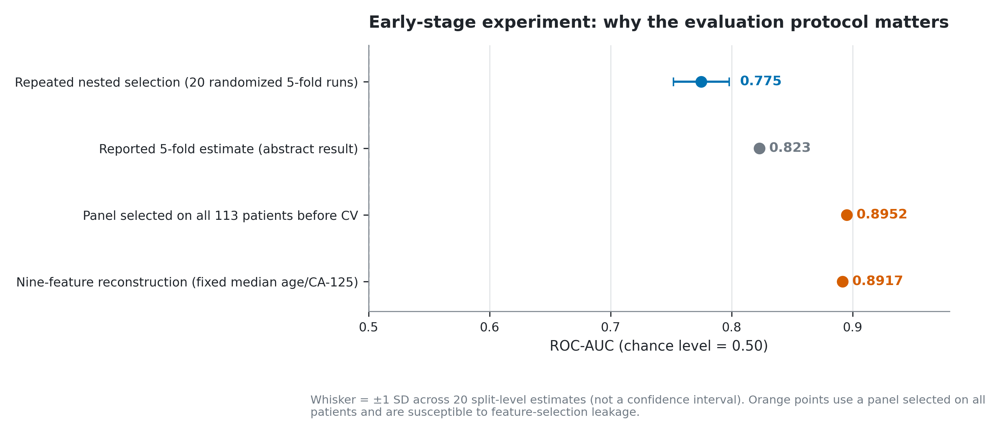
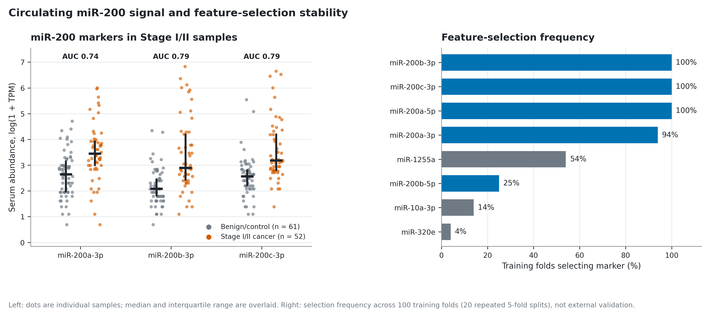
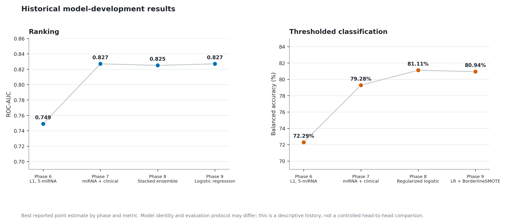
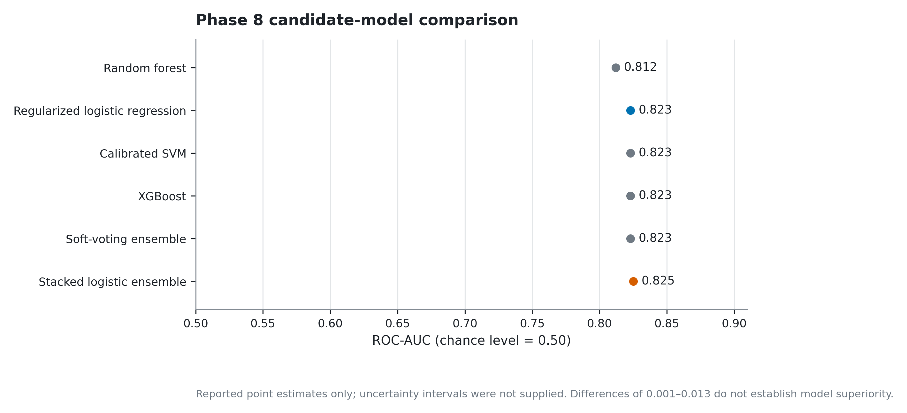
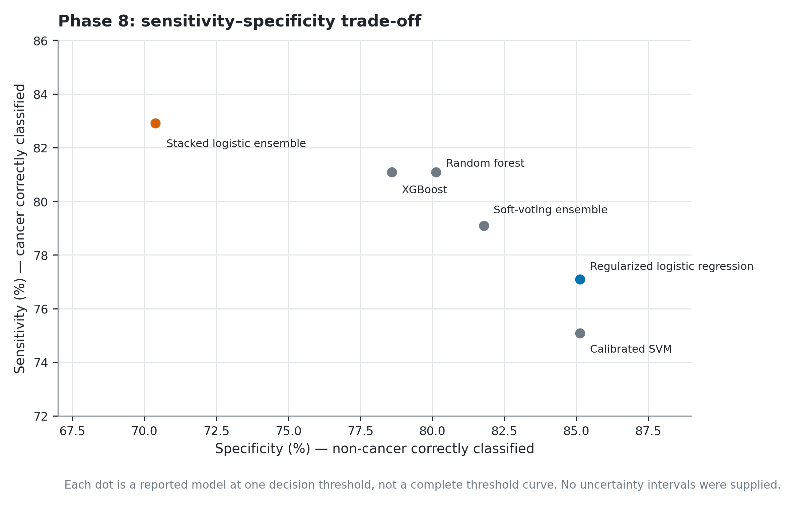
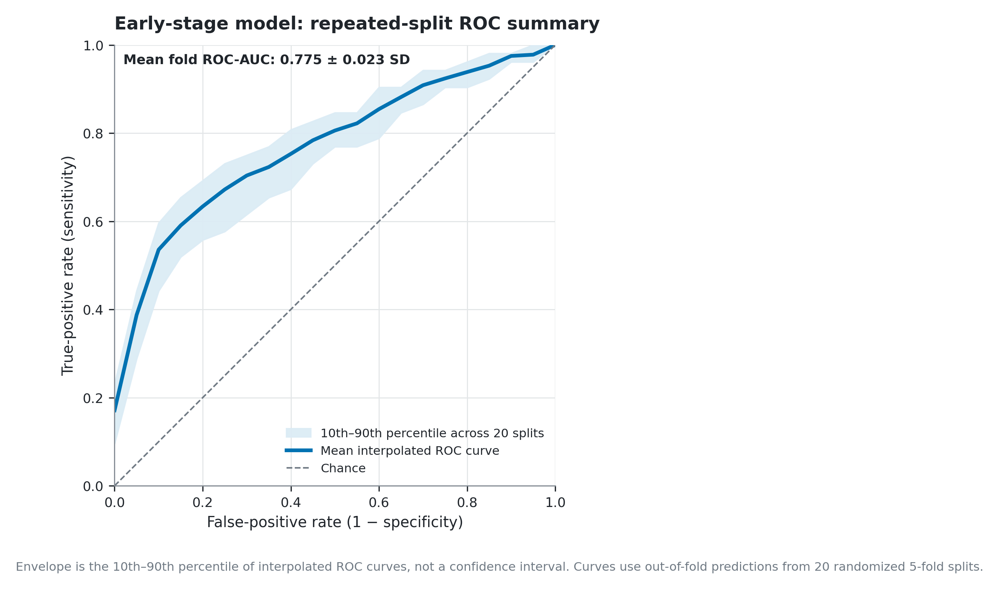
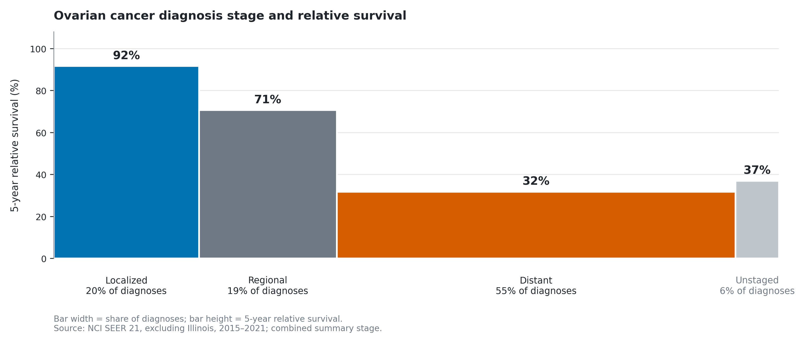

# OVAI

Research prototype for studying how combining symptomatic and clinical data can improve detection of early-stage epithelial ovarian cancer.

## Research abstract

**Title:** *OVAI: Evaluating Machine Learning for Ovarian Cancer Classification Using Circulating microRNAs and Clinical Variables*

**Authors:** Shaun Murzello, Ryan Agahian, Dylan Ardaya, Anthony Nguyen, Kush Rao, Caden Guo

**Date:** October 2026


### Abstract

Epithelial ovarian cancer is frequently undiagnosed at earlier stages, motivating research into biomarkers that could potentially be used to improve classification and identification. We have developed OVAI, a machine-learning pipeline prototype that is used to distinguish between Stage I/II epithelial ovarian cancer samples and benign ovarian instances and controls using circulating miRNA expression data from blood specimens. Using data from the publicly available GSE94533 cohort, we analyzed 113 patients for this task, including 52 Stage I/II cancer cases and 61 benign/control cases, excluding stage III/IV cancer cases and borderline tumors. We tested a logistic regression model using 5 selected miRNAs through five-fold cross-validation, repeatedly training on 80% of patients and testing on the remaining 20%. Feature selection and data preprocessing were performed using only the training data to prevent any possible data leakage.

When tested using the five held-out folds, the model achieved a mean five-fold ROC-AUC of 0.823 and balanced accuracy of 81.1%, with 77.1% sensitivity and 85.1% specificity. We also developed an interface that allows users to enter patient age, CA-125 levels(a blood biomarker), and five circulating miRNA measurements or upload patient data in an Excel format, generating an estimated malignancy probability. The prototype provides results similar to how a diagnostic tool might be used in a healthcare setting or lab. In a separate reconstructed five-fold evaluation of the nine-feature model, using fixed median defaults for age and CA-125 because patient-level values were unavailable, the model achieved an improved 84.07% accuracy, 83.54% balanced accuracy, and a ROC-AUC of 0.8917.

In a separate cancer vs. non-cancer testing of the full 179-patient cohort, a regularized logistic regression model combining 14 miRNAs with age and CA-125 achieved a cross-validated ROC-AUC of 0.813, compared with 0.779 for the 14-miRNA model alone. These are preliminary estimates from a single cohort, not independent validation, which require further evaluation using an independent cohort with a similar structure to further assess the potential clinical utility. Unfortunately, we were not able to do so due to the limited data that uses the Illumina NextSeq 500 system.

**Keywords:** Ovarian cancer; Early-stage detection; Circulating microRNA; Machine learning; Biomarker discovery; Computational oncology; CA-125

## How to Run

### 1. Open the repository in Codespaces

1. Open this repository on GitHub and select the `anthony` branch.
2. Click **Code → Codespaces**.
3. Click **Create codespace on anthony**.

### 2. Install the app's dependencies

In the Codespaces terminal, run these commands from the repository root:

```bash
python -m pip install --upgrade pip
python -m pip install -r requirements-portal.txt
```

### 3. Start the app

Run:

```bash
python -m streamlit run scripts/ovarian_diagnostic_portal.py --server.address 0.0.0.0 --server.port 8501 --browser.gatherUsageStats false
```

Codespaces should detect port **8501** and show a notification to open the forwarded app. If it does not, open the **Ports** tab, find port `8501`, and click its browser/open icon. Do not delete the terminal process while running the app.


---

## Metric Audit



[PDF](images/metric_audit.pdf) · [SVG](images/metric_audit.svg)

The repeated nested-selection reimplementation yielded a mean ROC-AUC of 0.775 (SD 0.023 across 20 randomized splits), while the abstract reports 0.823. Results near 0.89 were obtained after selecting the miRNA panel using all 113 patients.

## miR-200 Biomarker Signal



[PDF](images/mir200_signal.pdf) · [SVG](images/mir200_signal.svg)

Each point represents one patient from the 113-sample early-stage cohort (52 Stage I/II cancers and 61 benign/control samples), with measurements shown as log(1 + TPM) and median/IQR overlays. The right panel shows feature-selection frequency across the 100 training folds.

## Model Development History



[PDF](images/model_development_history.pdf) · [SVG](images/model_development_history.svg)

The best reported ROC-AUC rose from 0.749 in Phase 6 to 0.827 in Phase 9, while the best balanced accuracy rose from 72.29% to 80.94%. Differences in evaluation for each version may exist, potentially making this data better used as evidence of development history.


## ROC-AUC comparison



[PDF](images/phase8_roc_auc_comparison.pdf) · [SVG](images/phase8_roc_auc_comparison.svg)

The six Phase 8 candidate models have reported ROC-AUC values between 0.812 and 0.825. At the moment, these small differences do not establish that one model is statistically superior than another.

## Sensitivity Specificity Trade-Offs



[PDF](images/phase8_sensitivity_specificity_tradeoff.pdf) · [SVG](images/phase8_sensitivity_specificity_tradeoff.svg)

Each point represents one model at its reported decision threshold, not a full threshold curve. The stacked logistic ensemble had 82.91% sensitivity but 70.38% specificity, whereas regularized logistic regression had 77.09% sensitivity and 85.13% specificity.

## Repeated Split ROC



[PDF](images/robustness_a_only.pdf) · [SVG](images/robustness_a_only.svg)

The line summarizes the interpolated ROC curves from 20 randomized stratified five-fold runs. The shaded band is the 10th–90th percentile across runs. Mean fold ROC-AUC was 0.775 (SD 0.023).

## Ovarian Cancer Stage and Survival



[PDF](images/unmet_need_seer.pdf) · [SVG](images/unmet_need_seer.svg)

In the cited SEER data, approximately 20% of ovarian cancer diagnoses were localized and 55% were distant. Rectangle widths represent each stage's share of diagnoses, and heights represent five-year relative survival.
([NCI SEER, 2015–2021](https://seer.cancer.gov/statfacts/html/ovary.html)).
